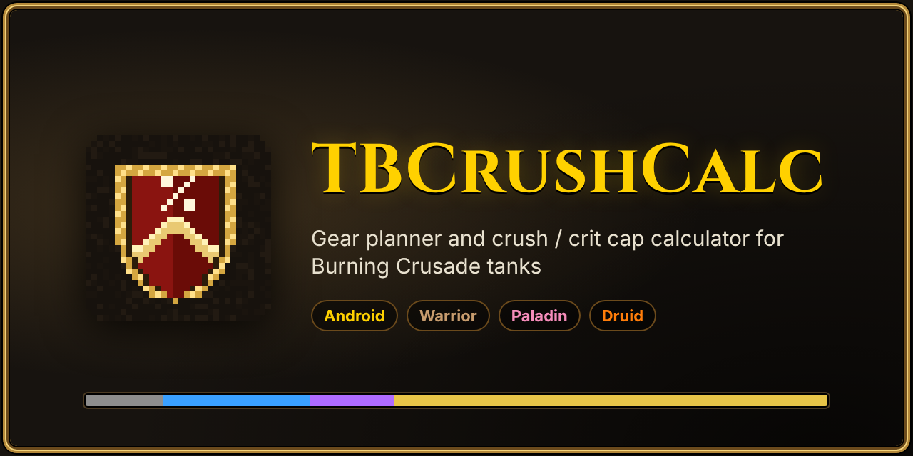
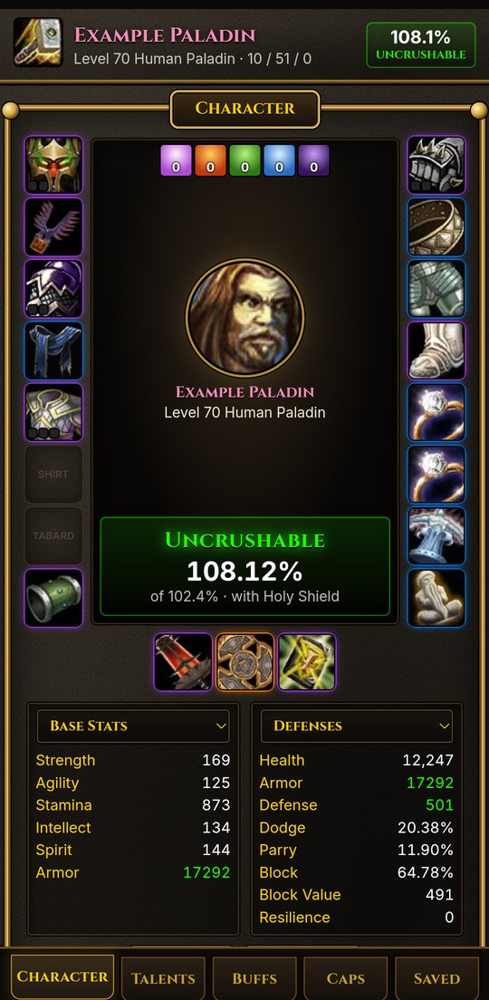
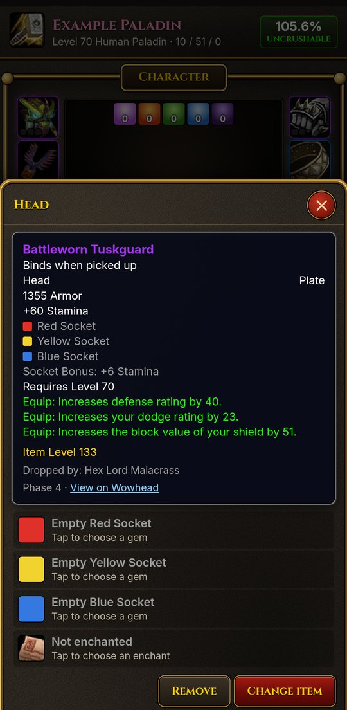
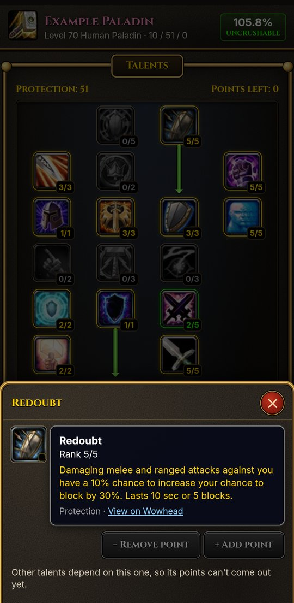
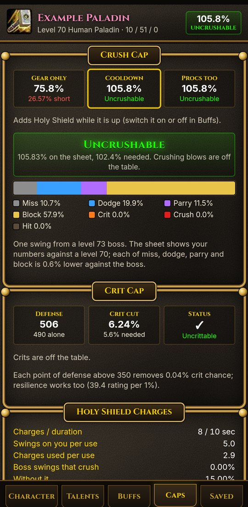

<p align="center">
  
</p>

<p align="center">
  <a href="https://github.com/kcham01/bigcrazyworld/raw/results/TBCrushCalc.apk"></a>
  <a href="https://github.com/kcham01/bigcrazyworld/issues/new?title=Bug:%20&labels=bug"></a>
  <a href="https://github.com/kcham01/bigcrazyworld/issues/new?title=Idea:%20&labels=enhancement"></a>
  <br>
  <a href="https://www.reddit.com/r/classicwow/submit?url=https%3A%2F%2Fgithub.com%2Fkcham01%2Fbigcrazyworld&title=TBCrushCalc%3A%20a%20crush%20cap%20and%20gear%20planner%20app%20for%20TBC%20tanks"></a>
  <a href="https://twitter.com/intent/tweet?text=Uncrushable%20yet%3F%20TBCrushCalc%2C%20a%20crush%20cap%20and%20gear%20planner%20for%20TBC%20tanks&url=https%3A%2F%2Fgithub.com%2Fkcham01%2Fbigcrazyworld"></a>
  <a href="https://github.com/kcham01/bigcrazyworld"></a>
</p>

**TBCrushCalc**<sup><sub> (calc is short for calculator btw)</sub></sup> is an Android app for Burning Crusade tanks. Put your gear on a character pane like the one in the game, spend your talent points, pick your raid buffs, and it tells you whether a raid boss can still land crushing blows and crits on you, and what would fix it.

It covers protection warriors, protection paladins and feral druids, with every TBC item, gem and enchant from phase 1 to phase 5.

<p align="center">
  
  
  
  
</p>

## What it does

- **Character pane.** All 17 equipment slots around your character, with item quality colours and Wowhead-style tooltips: sockets, socket bonuses, set bonuses, enchants, item level, where it drops and a link to Wowhead.
- **Gear, gems and enchants.** Search every item your class can wear, filter by phase and armor type, and sort by how much avoidance each one adds. Gems show whether they match the socket; meta gems show whether their requirement is met.
- **Talents.** The three trees as in the game, with the 61-point limit, rows unlocked every 5 points and prerequisite arrows.
- **Buffs.** Raid buffs (with their improved talents), flasks, elixirs and food, following the game's flask and elixir rules. Holy Shield, Shield Block, Redoubt, Dire Bear Form and on-use trinkets can be switched on and off.
- **Caps.** Your total against the 102.4% crush cap with gear only, with your block cooldown, and with procs. It also shows:
  - the boss's attack table as a bar;
  - the crit cap;
  - Illidan's Shear;
  - how much of each stat would close the gap;
  - where every percent comes from.
- **Block charges.** A simulation of a boss (and adds, if you want) swinging at you while you press Holy Shield or Shield Block on cooldown. It shows whether the charges really cover you or run out.
- **Alts.** Save as many characters as you like, each with its own gear, talents, race and buffs. Copy, rename or delete them, and share them as a text code.

## Install

1. Download [TBCrushCalc.apk](https://github.com/kcham01/bigcrazyworld/raw/results/TBCrushCalc.apk) on your phone.
2. Open it and allow installing from your browser or file manager if Android asks.
3. It works offline. Item icons come from Wowhead, so they need a connection the first time.

## The maths, briefly

A boss swing is one roll, read in order: miss, dodge, parry, block, crit, crushing blow, hit. A level 73 boss takes 0.6% off each of your miss, dodge, parry and block, so your character sheet needs **102.4%** combined before crushing blows (15% of swings, at 150% damage) fall off the table.

Each defense point above 350 removes 0.04% of the boss's 5.6% crit chance. That means 490 defense for warriors and paladins, or 415 for a druid with 3/3 Survival of the Fittest. Resilience counts too.

## Building it yourself

```
npm ci
node tools/build.mjs          # the app, into build/web
node tools/build.mjs --tests && node build/tests/run.js
```

The APK is built by GitHub Actions (`.github/workflows/build.yml`). It is then tested by tapping through every screen on an Android emulator. The APK, screenshots and logs go on the `results` branch.

## Licence

GPL-3.0-or-later. See [LICENSE](LICENSE).

## Credits

| Software / data | Used for | Licence |
| --- | --- | --- |
| [wowsims/tbc](https://github.com/wowsims/tbc) | Items, gems, enchants, base stats, talent layout | MIT |
| [oppahansi/ltc](https://github.com/oppahansi/ltc) | Talent names, descriptions and icons | GPL-3.0 |
| [Wowhead](https://www.wowhead.com/tbc) | Item icons and item links | Linked, not copied |
| [Cinzel](https://fonts.google.com/specimen/Cinzel), [Inter](https://rsms.me/inter/) | Fonts | SIL OFL 1.1 |
| [esbuild](https://esbuild.github.io/), [TypeScript](https://www.typescriptlang.org/) | Building the app | MIT, Apache-2.0 |
| [AndroidX WebKit](https://developer.android.com/jetpack/androidx/releases/webkit) | Serving the app inside the APK | Apache-2.0 |

World of Warcraft and The Burning Crusade are trademarks or registered trademarks of Blizzard Entertainment, Inc. TBCrushCalc is a fan-made tool and is not made, endorsed or supported by Blizzard Entertainment.
